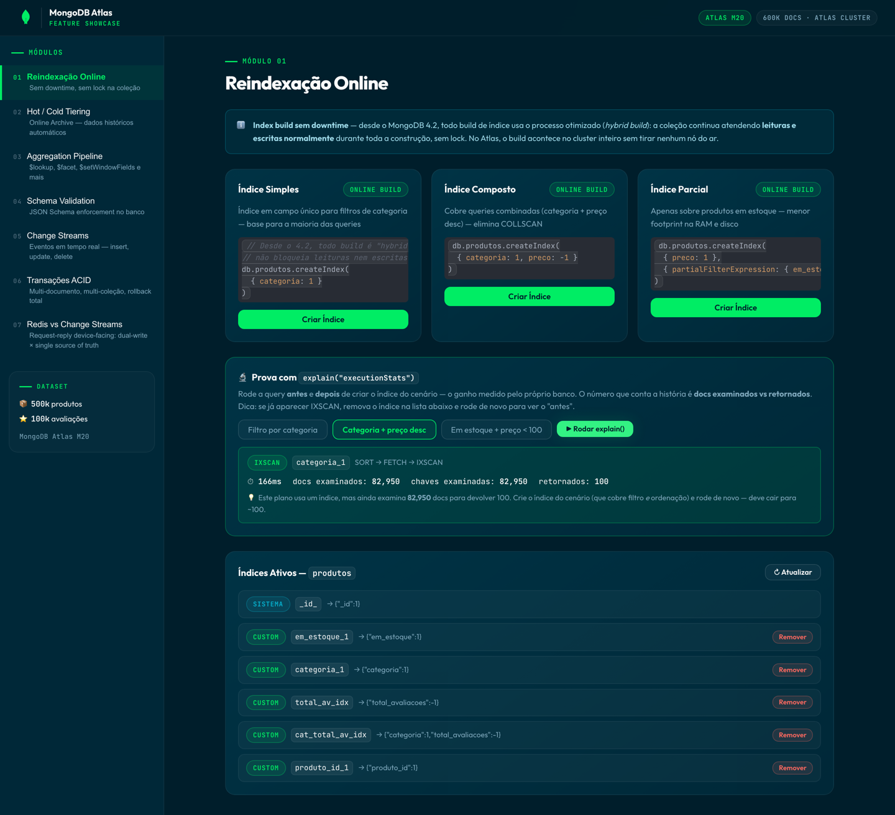
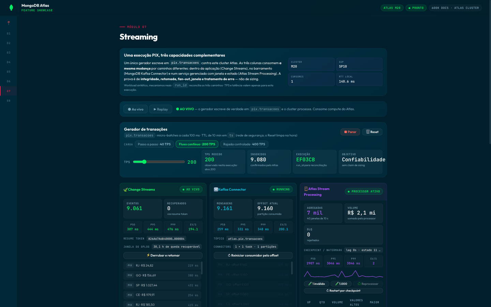
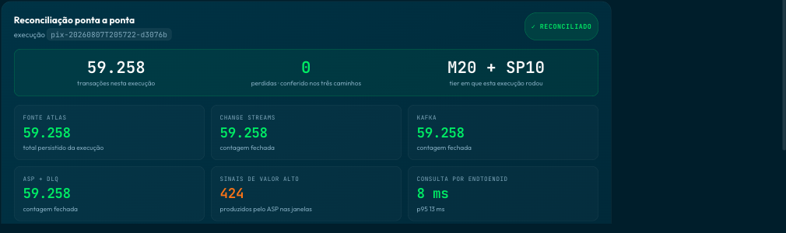
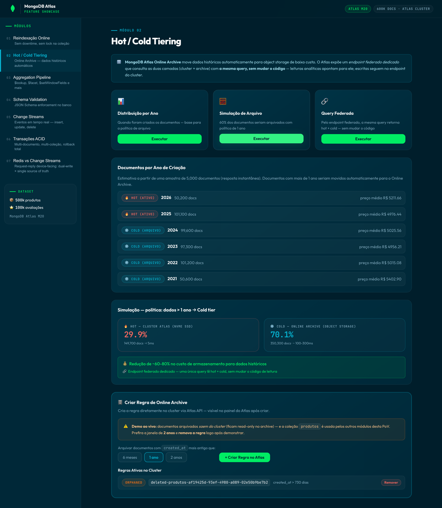
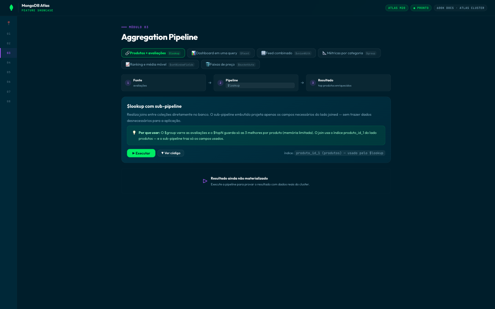
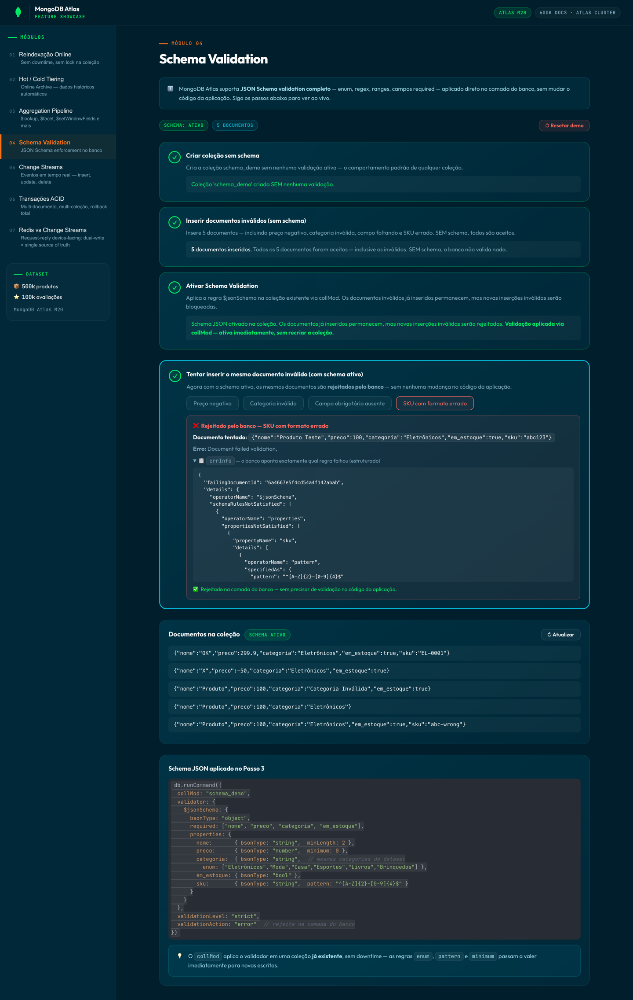
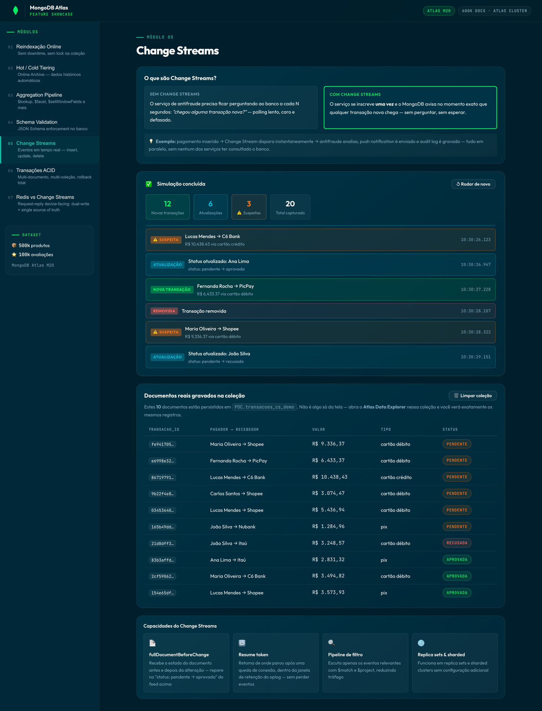
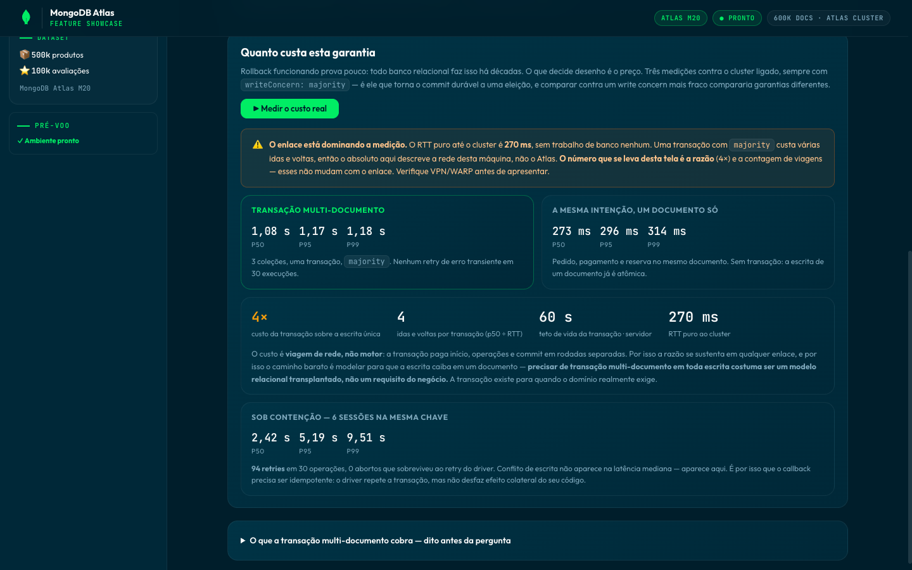
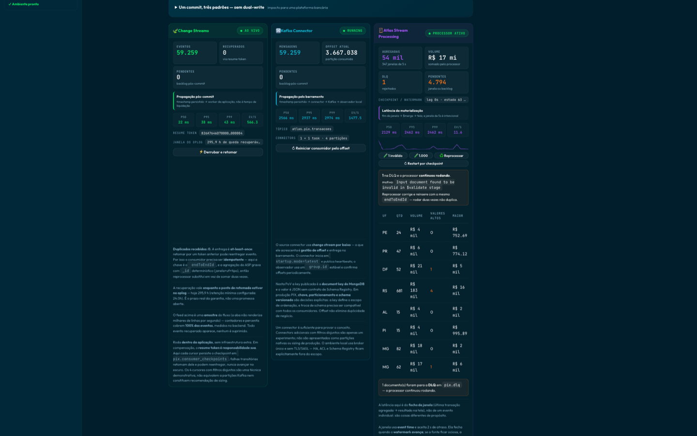

# MongoDB Atlas feature showcase

Seven Atlas capabilities, one page each, running against a real cluster. Build an index and watch reads keep flowing. Break a change stream and watch it resume from its token. Roll back a transaction and watch the documents return.

Mapa do código: [docs/MAPA_DO_CODIGO.md](docs/MAPA_DO_CODIGO.md)

Nothing is mocked. If a piece is not configured, the UI says so instead of inventing a number.

FastAPI + React 19. The UI is in Brazilian Portuguese. No LLM.

## The modules

The app opens on a **thesis** page, not on module 01: none of the capabilities is exclusive to MongoDB, and the argument is not any single capability. It is the convergence of all of them over the same data, in the same cluster, in the same language. The page also states what the demo does *not* prove (it is not a competitive benchmark, does not estimate savings, and does not replace the warehouse).

**Measure it now.** The thesis page has a *Medir agora* button (`POST /tese/medir`): through the app's single `MongoClient`, against the same cluster, it runs one real operation per capability (ping, indexed find, aggregation, a schema rejection, a change-stream delivery, a two-collection transaction) five times and shows p50/max with the evidence for each (index used, `code 121` rejections, events delivered, commits). Nothing on that table is stored in the code. A collapsed panel lists what each capability needs outside Atlas in a stack assembled from separate services; it is labelled as an architecture comparison, not a measurement.

| Module | What Atlas does |
|---|---|
| **01** Online reindexing | Rolling index build with no downtime. `scripts/live_monitor.py` prints read/write latency while it happens. |
| **02** Hot/cold tiering | Online Archive moves old documents to cheap storage, still queryable in a single namespace. |
| **03** Aggregation Pipeline | `$lookup`, `$facet`, `$unionWith`, `$setWindowFields`, `$bucketAuto`. |
| **04** Schema validation | `strict` rejects new violations; `validationLevel: constraint` (MongoDB 9.0+, per the [9.0 manual](https://www.mongodb.com/docs/manual/core/schema-validation/specify-validation-level/); GA/Preview status still to be confirmed against the release notes) checks and enforces the contract for existing data too. |
| **05** Change Streams | Ordered feed of inserts/updates/deletes with pre/post-images: an update shows the old status, a delete shows the removed document. |
| **06** ACID transactions | Multi-document transactions walked step by step, rollback included, and measured: `majority` latency, the cost over the same single-document write, and behavior under contention. |
| **07** Streaming | Change Streams, Kafka Connector, and Atlas Stream Processing over the same writes. |

The geospatial-risk module (formerly 08) became a standalone PoV: [`mongodb-atlas-geo-showcase`](https://github.com/adrianofratelli-glitch/mongodb-atlas-geo-showcase).

Each module states where its capability does **not** go, before anyone asks.

Every module has a deep link: `/#tese`, `/#agg`, `/#streams`, `/#tx`, …

**Module 01: the index is built while reads keep flowing:**



## Quick start

```bash
cd backend && python -m venv venv && source venv/bin/activate
pip install -r requirements.txt
cp .env.example .env          # MONGO_URI, optionally the Atlas API keys
cd ../frontend && npm ci && cd ..
# idempotent reset: data + B-tree indexes + streaming leftovers (safe to rerun)
MONGO_DB=showcase_poc_test STREAMING_DB=showcase_pix_test GEO_DB=showcase_geo_test backend/venv/bin/python scripts/reset_demo.py
MONGO_DB=showcase_poc_test STREAMING_DB=showcase_pix_test GEO_DB=showcase_geo_test ./start.sh   # API :8002 + UI :5174
```

`scripts/reset_demo.py` is the single reset. Unless `ALLOW_DEMO_DB_WRITE=1` is set, it refuses a `MONGO_DB` that does not end in `_test`, and a `STREAMING_DB`/`GEO_DB` that is not this PoV's own `showcase_*_test`: the streaming cleanup drops whole collections there, and a generic `*_test` may belong to another PoV on the same cluster (`geo_test` is the geo showcase's). With the flag, only the names configured in `backend/.env` (or the code defaults `pix`/`geo`) are accepted, never a name exported in the shell. `scripts/cleanup-streaming-data.py` applies the same rule on its own; `bin/overview` passes the flag because it owns the demo lifecycle (`ALLOW_DEMO_DB_WRITE=1 backend/venv/bin/python scripts/reset_demo.py` for the demo database, never during a live demo). It drops only collections the modules create, removes only indexes created by module 01 (`demo01_` prefix), upserts `produtos`/`avaliacoes` deterministically (a rerun never duplicates) and cleans the streaming run. It never drops `produtos`/`avaliacoes`, because in a shared demo database they may belong to another PoV as well. `--check` only verifies. The first run on an empty database writes 120k documents (164.6 s measured over the network to an M20); a rerun on populated data took 5.5 s.

The launcher uses a no-reload backend and an optimized frontend build by default. For reload/HMR development run `POV_DEV=1 ./start.sh`; the build is only redone when sources, lockfile, or configuration change.

Run `curl http://localhost:8002/preflight` before presenting. It checks the URI, cluster, collections, Atlas keys, and the mutation guard.

### What each mode needs

| Mode | Command | Needs |
|---|---|---|
| Web demo (modules 00–07; without Kafka/ASP module 07 says "not configured") | `./start.sh` | `backend/.env` with `MONGO_URI`, the venv, `frontend/node_modules`, data from `reset_demo.py` |
| Module 07 fallback | `./bin/overview --replay` | the same, plus the recorded run in `backend/data/replay_streaming.json` |
| Full live demo | `./bin/overview` | the same, plus an Atlas Stream Processing workspace (`ASP_CONNECTION_STRING`, a connection named `ASP_CONNECTION_NAME` pointing at the cluster), `mongosh`, and `brew install kafka` (binaries only) |

The full live mode depends on infrastructure outside this repository. `bin/overview` checks it first and, if the ASP connection string or `mongosh` is missing, stops with a message naming what is missing and pointing to `--replay` / `./start.sh`; missing Kafka is a warning (column 2 shows "not configured"). `scripts/kafka-local.sh` runs the broker and Kafka Connect as processes of this PoV (data and logs in `KAFKA_RUN_DIR`, KRaft controller on port 19093): it never calls `brew services`, and `down` stops only what it started. Setup of each piece: [docs/setup-streaming.md](docs/setup-streaming.md).

Once configured, `bin/overview` replaces all of that:

```bash
./scripts/prepare-demo.sh   # ahead of time: reset_demo.py + --check (needs ALLOW_DEMO_DB_WRITE=1 for the demo db)
./bin/overview              # preflight, backend, frontend, Kafka, ASP
./bin/overview --replay     # recorded fallback, nothing written to the cluster
./bin/overview down         # stops everything; the cluster is left untouched
```

**Run `overview down` when you finish**: a stream processor is billed per second. As a safety net, `up` already schedules that `down` for 45 minutes later; `overview manter` cancels it and `overview adiar 30` reschedules.

Details: [Streaming setup](docs/setup-streaming.md) · [reference](docs/reference.md) (Portuguese).

### Docker

One container: nginx serves the frontend build and proxies `/api` to a single uvicorn worker with the prefix removed, as the Vite proxy does; SSE feeds are unbuffered.

```bash
docker build -t atlas-showcase .
docker run --env-file backend/.env -p 127.0.0.1:18002:8080 atlas-showcase   # http://127.0.0.1:18002
```

Prebuilt image (published to GHCR on every push to `main` that touches the image):

```bash
docker pull ghcr.io/adrianofratelli-glitch/mongodb-atlas-feature-showcase:latest
docker run --env-file backend/.env -p 127.0.0.1:8080:8080 ghcr.io/adrianofratelli-glitch/mongodb-atlas-feature-showcase:latest
```

Same `--env-file` rule as above (`KEY=value`, no quotes); tags: `latest` and `sha-<7-char commit>`.

`docker run --env-file` does not strip quotes: a line `KEY="value"` arrives with the quotes, so write `KEY=value` in the file you pass. For UI mutations, add the page origin (e.g. `http://127.0.0.1:18002`) to `ALLOWED_ORIGINS`; keep the port bound to `127.0.0.1`, because behind nginx every request reaches the backend from loopback. Module 07 runs from the recorded replay; the live Kafka/ASP mode (`bin/overview`) stays on the host (`localhost` inside the container is not the host: use `KAFKA_BROKERS=host.docker.internal:9092` if needed). Health: `GET /api/health/live`; readiness: `/api/preflight`.

## Module 07: three consumers, one write

Change Streams in the application, the Kafka Connector publishing to a real broker, and Atlas Stream Processing aggregating 5s windows, all over the same writes. The flow has two channels: `PIX` (no coordinate, because a PIX transfer has none) and `CARTAO_PRESENCIAL` (card-present, with the acquirer terminal's coordinate, consumed by the `geoSinais30s` processor; the geospatial module that displayed it now lives in its own repository).



**Break it on purpose.** Four buttons sit next to the generator: *kill the connector* (stops mid-flow and resumes from the stored offset), *inject an invalid event* (a string `valor`, diverted to the DLQ by the processor's `$validate`), *publish an incompatible schema version* (the required field `valor` renamed to `amount`, the change a Schema Registry would refuse), and *force a primary failover* (Atlas's test failover, on the cluster, under load).

Then watch the reconciliation close anyway, and it checks three things, not one: **count** (nothing missing), **value** summed in integer cents (a volume check; on its own it does *not* prove nothing changed, because mutations that cancel out, such as 10 and 20 becoming 11 and 19, keep the same total), and a **content digest**: for every document, each path computes a SHA-256 of a canonical form of *all* its fields (BSON from the source and Change Streams and extended JSON from Kafka normalized to the same values: numbers as normalized decimals, dates as UTC milliseconds, ObjectIds as hex, sorted keys), aggregated in `endToEndId` order and compared against the same digest computed from the source. It only matches when every document carries the same content as the source. Declared limits: the canonical form compares numeric value, not BSON type (int `5` vs double `5.0` is not flagged); the source digest is computed once the generator stops and skipped above 200,000 documents per run (the page says so); ASP delivers per-window aggregates, so it reconciles by count and value within a declared rounding tolerance, with no per-document digest. Measured on 2026-10-09 against `_test` databases with real Kafka, Connector, and ASP: 2,230 documents, identical content digest across source, Change Streams, and Kafka, 0 duplicates. Recorded in an earlier live run through a real election (set digest at the time, not re-measured): 332,568 documents, R$ 104,486,759.65 identical across the three paths, 0 writes rejected after driver retry, 0 duplicates.



Delivery is at-least-once, stated above the numbers and not in a footnote: after a resume the same event may arrive twice, and the unique index on `endToEndId` is what makes that safe. Ordering holds within a partition, not across partitions.

**What did it cost?** A throughput number alone invites the wrong reading (*so that is all Atlas does?*) because it never says whose ceiling was reached. The page reads the primary's CPU through the Atlas Admin API, clipped to the run's own window, and places it next to the TPS that produced it: in earlier recorded runs, **~1,600 TPS sustained for two minutes on an M20, with 29–53% primary CPU** (the panel always shows the run in front of it, never a stored number). Two traps live here, and both were found by measuring, not assuming. Atlas publishes process metrics with a one-to-two-minute delay, so a panel queried right after a 30s run describes the cluster *before* the load; it now says `metricas_pendentes` instead of concluding. And a run shorter than the one-minute publication interval is averaged with the rest of that idle minute: the same load read 43% when it fell inside one bucket and 15% when it straddled two, so short runs are labelled as a floor.

The last panel answers the question that comes after *does it work?*: **what drops out of the design**. It compares the components each path requires, without inventing savings. The Kafka row stays correct whenever the event must reach systems outside Atlas, which is why it is in the demo, working.

The geospatial-risk module (formerly 08: retrospective impossible-travel investigation and the five geospatial query operators) was extracted to the standalone repository [`mongodb-atlas-geo-showcase`](https://github.com/adrianofratelli-glitch/mongodb-atlas-geo-showcase) on 2026-09-11.

## More screenshots

| Hot/cold tiering | Aggregation Pipeline |
|---|---|
|  |  |

| Schema validation | Change Streams |
|---|---|
|  |  |

| ACID transactions | Module 07, three columns |
|---|---|
|  |  |

## Security

Some of these demos destroy real things: they drop indexes, run `collMod` on validation rules, and create and delete Online Archives. That is why the blast radius stays local: the launcher listens on `127.0.0.1`, browser mutations are only accepted from configured origins, remote mutations require `DEMO_ADMIN_TOKEN`, bodies are size-limited, and errors return a request id instead of a trace.

The application also closes the streaming client through FastAPI's lifespan and returns browser-hardening headers. `/api/health` stays public; mutation authorization does not make the embedded Kafka lab production-ready.

**Never point this at anything other than a disposable demo cluster.**

On a shared network, set a long, random `DEMO_ADMIN_TOKEN` in `backend/.env` and mirror it as `VITE_DEMO_API_TOKEN`. The embedded Kafka stack is a single-node lab, with no TLS, SASL, ACLs, or Schema Registry.

## Stack

Python 3.11+ · FastAPI · PyMongo · React 19 · Vite · MongoDB Atlas. Module 07 optionally needs a local Kafka broker and an ASP instance.

```bash
pip install -r backend/requirements-dev.txt
pytest             # 270 unit + adversarial tests, stubbed Mongo, no cluster needed
ruff check backend
(cd frontend && node --test tests/*.test.mjs)   # 14 frontend tests (formatters, useApi, polling)
```

Live tests run every module (00–07) against a real cluster, opt-in and only on this PoV's own `showcase_*_test` databases (the streaming reset wipes `<GEO_DB>.sinais_ao_vivo`, so a generic `geo_test` shared with another PoV is refused). They start their own backend on a free port with ASP off and Kafka pointed at a dead port, so they never start a billed stream processor:

```bash
LIVE_TESTS=1 MONGO_DB=showcase_poc_test STREAMING_DB=showcase_pix_test GEO_DB=showcase_geo_test \
  backend/venv/bin/python -m pytest -m live backend/tests/live
```

Why they are opt-in and what they write: [ADR 0001](docs/adr/0001-testes-live-opt-in.md).

[`ARCHITECTURE.md`](ARCHITECTURE.md)

## License

MIT
